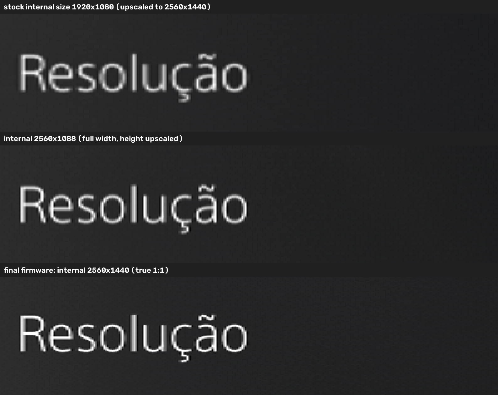

# MS2131 true 1440p capture firmware

Firmware patch for HDMI → USB 3.0 capture cards based on the **MacroSilicon MS2131** (`345F:2131`).
It adds a real **2560x1440 @ 30 fps** capture mode (YUY2 / MJPEG).



## Motivation

My card offered 1080p60 or "4K at 18 fps". I wanted at least 1440p30. The "4K" mode turned out to be a 1080p
image stretched inside the chip, and no setting on the PC could change that.

## Hardware limits

- The chip stores every frame in a memory of 4,194,304 pixels. 4K needs 8.3 million, so **real 4K capture is
  impossible**. 1440p needs 3.7 million and fits.
- The stock firmware reserves 3840 pixel slots per line, which leaves only 1092 lines. That waste, plus a
  1920x1080 size limit, is what kept the card at 1080p.
- A 4K60 source is halved to 1920x1080 at the chip's input. **You only get real 1440p from a 1440p source.**
- Output is 8-bit SDR. The 1440p mode has a single frame rate (30 fps).

## The idea

1. Reuse the fake 4K18 slot in the USB descriptor for 2560x1440@30 (the firmware already had that timing).
2. Raise the internal size limit from 1920x1080 to 2560x1440.
3. Make the firmware reserve only as many pixel slots per line as needed, so 1440 lines fit. The right value
   depends on the input signal, so a 79-byte routine picks it each time the mode changes.
4. Optionally turn off the chip's sharpening filter, which looks harsh at 1:1.

Everything was found over USB, by dumping the flash, disassembling the 8051 code and reading the chip's
registers while it runs. Full write-up, register map and measurements: [docs/details.md](docs/details.md).

## Results

Tested on one card with a PS5 Pro as source.

| Mode | Measured fps | Corrupt rows |
|---|---|---|
| 2560x1440 @ 30 YUY2 / MJPEG | 29.98 | 0 |
| 1920x1080 @ 60 YUY2 / MJPEG | 59.98 | 0 |

| Source | 2560x1440 capture is | Edge width (H / V) |
|---|---|---|
| 1440p60 | real 1:1 | 2.1 px / 1.6 px |
| 4K60 | upscaled 1080p | 2.85 px / 2.70 px |

With a 1440p source, fine detail is 5 to 13 dB stronger than what the stock firmware's upscaled modes carry.
On soft content such as console menus the visible gain over 1080p is small.

## How to flash

**This can brick your card. One card and one firmware build were tested. Back up first.**

Needs Python 3 on Windows and `pip install hidapi`. Close OBS and any program using the card.

```
python tools/ms2131_flash.py read my_backup.bin
python tools/patch_1440p.py my_backup.bin my_patched.bin --no-sharpen
python tools/ms2131_flash.py write my_patched.bin --yes-write-flash
```

1. `read` saves your current firmware. Keep that file. Then unplug and re-plug the card.
2. `patch_1440p.py` builds the new image from your own backup. It checks every byte it changes and prints
   `ABORT` if your firmware is a different version. If it aborts, do not flash anything.
3. `write` programs and verifies. Do not unplug during the write (about a minute).
4. Unplug the card, wait a few seconds, plug it back in.
5. In OBS pick `2560x1440`, 30 fps, YUY2, and set your source to 1440p.

To go back: `python tools/ms2131_flash.py write my_backup.bin --yes-write-flash`, then re-plug.

Prebuilt images for the tested firmware are in [`firmware/`](firmware/). Use them only if the SHA-256 of your
backup is exactly:

`45a74613c52727b3eae0aeec05a479a0b489e17254d15c2625f7f786be208134`

## Credits

Flash protocol from [steve-m/ms213x_flash](https://github.com/steve-m/ms213x_flash). Scripts are MIT
licensed; the firmware images are modified copies of the vendor firmware and are provided without warranty.
