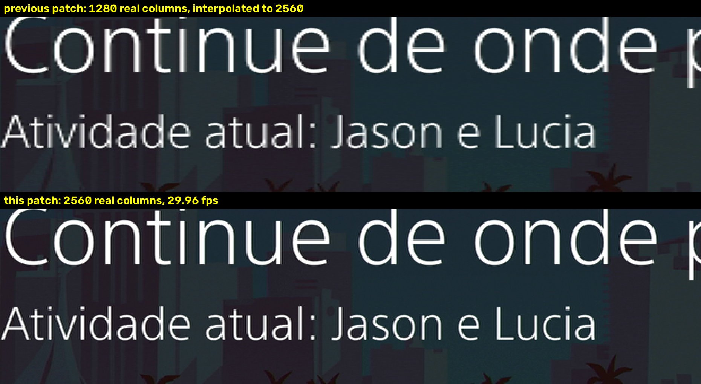

# MS2131 capture firmware: real 2560x1440 at 30 fps

Firmware patch and reverse-engineering notes for HDMI → USB 3.0 capture cards based on the
**MacroSilicon MS2131** (`345F:2131`).

With a 2560x1440@60 source, the **real 1440p** firmware delivers **2560x1440 with real pixels on both axes
at 29.97 fps** (YUY2), without a tear line. The stock firmware tops out at 1920x1080, and its "4K" mode is an
upscaled 1080p picture.




Full frame: [images/capture_2560x1440_real.png](images/capture_2560x1440_real.png)
(PS5 Pro at 1440p60, YUY2 2560x1440).

> **History.** The first version of this repository claimed "true 1440p", but its frames had 1280 real
> columns interpolated to 2560. That image is still here as `ms2131_1440p30*.bin` and labelled for what it
> is. The real 1440p firmware below fixes it, and the test that caught the error is the one used to verify
> the fix.

## Real resolution by source

| Source | Stock firmware | 1440p patch (old) | **Real 1440p patch** |
|---|---|---|---|
| 2560x1440 @ 60, capture 2560x1440 YUY2 | — (no such mode) | 1280x1440 | **2560x1440, 29.97 fps** |
| 2560x1440 @ 60, capture 2560x1440 MJPEG | — | 1280x1440 | not tested (routine does not act) |
| 3840x2160 @ 60 | 1920x1080 | 1920x1080 | 1920x1080 |
| 1920x1080 @ 60 | 1920x1080 | 1920x1080 | 1920x1080 |

"Real" means each pixel was checked: every pixel is fitted from its neighbours of the other column (and row)
phase. With interpolation, one phase is predictable (ratio ≈ 0.2); with real pixels, both phases behave the
same (ratio ≈ 1.0).

| Capture (2560x1440 YUY2, PS5 Pro 1440p60) | Horizontal ratio | Vertical ratio |
|---|---|---|
| 1440p patch (old) | 0.17 | 0.99 |
| Real 1440p patch | **0.98–0.99** | **0.99** |

## How it works

Short version; the measurements are in [docs/details.md](docs/details.md#real-1440p).

1. **Memory.** The frame memory has 4,194,304 pixel slots split into two buffers of 2,097,152 (a double
   buffer). 2560x1440 needs 3,686,400. The firmware joins the two into one buffer.
2. **No width halving.** The pre-scaler is set to 1:1, so all 2560 columns are stored instead of 1280.
3. **Memory bandwidth.** Writing 2560 columns of a 1440p60 signal (about 241 Mpixel/s) leaves room for
   reading the frame out at only 80 MHz (19.6 fps). The firmware raises the internal DRAM clock from 180 to
   **210 MHz**. That is enough to read at 120 MHz, which gives 29.97 fps.
4. **No tear line (genlock).** With one buffer, the input writes a new frame while the output is still
   reading the previous one. Where the writer passes the reader, the picture is cut into two frames, and
   with free-running clocks that cut rolls through the picture. The firmware now:
   - runs the output at half the input rate (29.971 fps for 59.94 Hz);
   - watches the start of every input frame (`0xe160`) and every output frame (`0xf1ac`);
   - stretches or shortens output frames by two lines to keep the cut outside the picture;
   - ignores a phase reading when no input frame edge was seen in the last 1.5 input frames, and keeps
     the output at its nominal timing until the reference comes back.
   The stock output watchdog is skipped in this mode, because its restarts threw the phase off.
5. All of this happens in a small routine in the firmware main loop. It acts only when the input and the
   capture are both 2560x1440 YUY2. Every other mode behaves like the 1440p patch, and boot is unchanged.

## Caveats

- **The DRAM runs 16.7% above the stock clock** once a 2560x1440 YUY2 capture starts, and stays there until
  the card is unplugged. The clock has no public documentation. It was tested on one card for minutes, not
  months. If you see the picture break up after the card warms up, flash back.
- **Lock-in.** When a capture starts, the tear line can show for a second or two while the genlock pulls
  the phase into place. The genlock is tuned for a 59.94 Hz source (PS5). It can follow sources between about
  59.86 and 60.02 Hz.
- **Thin cut at the bottom edge.** In fast motion a cut can still show now and then in the last rows of the
  picture. With this timing the phase range that keeps the cut fully outside the picture is only ~0.1 ms
  wide, and the lock moves by about that much.
- **Stock output watchdog off in this mode.** If the output ever stalls, close and reopen the capture.
- **YUY2 only.** The routine checks the UVC format index and does nothing for MJPEG (format 1). MJPEG at
  2560x1440 was not tested: DirectShow on the test machine always negotiated YUY2.
- The capture runs at 29.97 fps instead of 30.00. Capture software handles this fine.
- Source must send 2560x1440 (for example PS5 set to 1440p).

## How to flash

**This can brick your card. One card and one firmware build were tested. Back up first.**

Needs Python 3 on Windows and `pip install hidapi`. Close OBS and any program using the card.

```
python tools/ms2131_flash.py read my_backup.bin
python tools/patch_real1440p.py my_backup.bin my_real1440p.bin
python tools/ms2131_flash.py write my_real1440p.bin --yes-write-flash
```

1. `read` saves your current firmware. Keep that file. Then unplug and re-plug the card.
2. `patch_real1440p.py` builds the image from your own backup. It refuses any firmware other than the
   tested stock build and checks that the result is byte-identical to the tested image. If it says `ABORT`,
   do not flash anything.
3. `write` programs and verifies. Do not unplug during the write (about a minute).
4. Unplug the card, wait a few seconds, plug it back in.
5. Capture at **2560x1440, 30 fps, YUY2**.

To go back: `python tools/ms2131_flash.py write my_backup.bin --yes-write-flash`, then re-plug.

Prebuilt images are in [`firmware/`](firmware/), with SHA-256 sums. Use them only if the SHA-256 of your
backup is exactly:

`45a74613c52727b3eae0aeec05a479a0b489e17254d15c2625f7f786be208134`

| File | What |
|---|---|
| `ms2131_real1440p30_genlock_v2.bin` | **Real 1440p, no tearing** (this README, built by `tools/patch_real1440p.py`) |
| `ms2131_real1440p30_genlock.bin` | First genlock version: now and then a tear line walked through the middle of the picture for a few seconds |
| `ms2131_real1440p30.bin` | Real 1440p, first version: 29.96 fps with a rolling tear line |
| `ms2131_1440p30_nosharpen.bin` | Old 1440p patch, sharpening off (1280 real columns) |
| `ms2131_1440p30.bin` | Old 1440p patch (1280 real columns) |

## More

[docs/details.md](docs/details.md) has the measurements, register notes, firmware layout and HID protocol.

## Credits

Flash protocol from [steve-m/ms213x_flash](https://github.com/steve-m/ms213x_flash). Register hints from
[hsdaoh](https://github.com/steve-m/hsdaoh) and the FOSDEM video team's
[ms-tools](https://github.com/BertoldVdb/ms-tools) notes. Scripts are MIT licensed; the firmware images are
modified copies of the vendor firmware and are provided without warranty.
