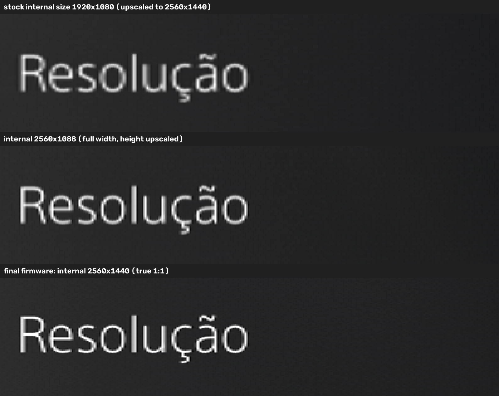
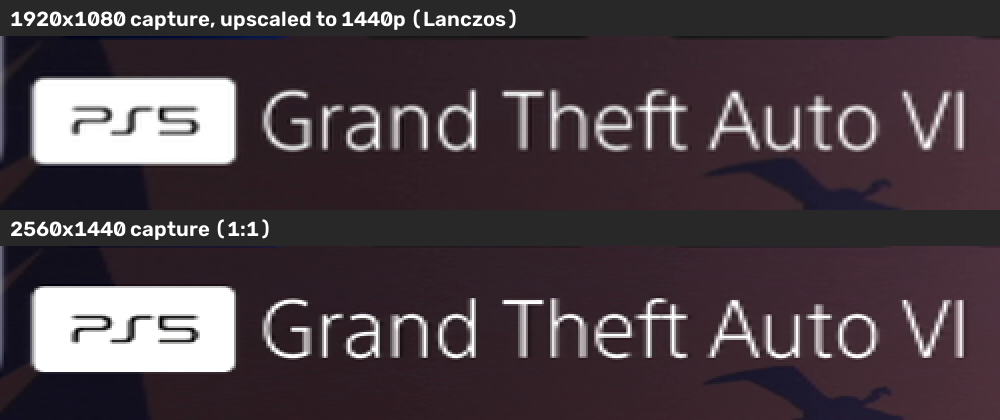
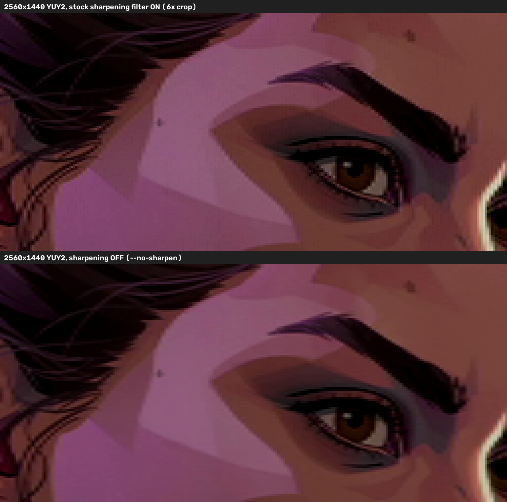

# MS2131 true 1440p capture firmware patch: full details

*[Back to the short README](../README.md)*

A firmware patch for HDMI → USB 3.0 capture cards built on the **MacroSilicon MS2131** chip that makes them
capture **real 2560x1440 at 30 fps** (YUY2 or MJPEG) from a 1440p source: every one of the 2560x1440 pixels
comes from the HDMI input instead of being upscaled from 1080p.

Out of the box these cards top out at 1920x1080@60 over USB. Some firmwares also list "3840x2160", but that
mode is a 1080p image stretched inside the chip. This repository documents why, and how the chip's frame
memory, which the stock firmware lays out wastefully, has room for real 1440p.



> **Read this first.** Flashing firmware can leave your card unusable. Everything here was developed and tested
> on **one** card with **one** firmware build. Make a backup first, check that your firmware matches, and do not
> flash if anything in the checks below differs. You do this at your own risk.

## Contents

- [What you get](#what-you-get)
- [Is my card compatible?](#is-my-card-compatible)
- [How to install](#how-to-install)
- [How to go back](#how-to-go-back)
- [Measured results](#measured-results)
- [How it works](#how-it-works)
- [What the patch changes](#what-the-patch-changes)
- [How it was found](#how-it-was-found)
- [Chip notes](#chip-notes)
- [Limits and things not tested](#limits-and-things-not-tested)
- [Credits and license](#credits-and-license)

## What you get

| | Stock firmware | Patched |
|---|---|---|
| Highest real capture resolution | 1920x1080 | **2560x1440** (with a 2560x1440 source) |
| 2560x1440 @ 30 fps mode | not offered | YUY2 and MJPEG |
| 3840x2160 @ 18 fps mode (upscaled 1080p) | offered | removed (its slot is reused) |
| 1920x1080 @ 60 and lower modes | yes | unchanged |
| Artificial sharpening in YUY2 | always on | off in the `nosharpen` build |

The 1440p mode replaces the "4K 18 fps" mode because the USB descriptor has exactly one spare slot and the 4K
mode was never real 4K (see [How it works](#how-it-works)).

**The source matters.** You only get real 1440p when the HDMI source sends 2560x1440. With a 4K60 source the
chip halves the picture at its input, so every mode, including this one, is built from 1920x1080
(see [Measured results](#measured-results)).

## Is my card compatible?

The patch was developed on this device:

| Property | Value |
|---|---|
| Chip | MacroSilicon MS2131 |
| USB ID | `345F:2131` |
| USB product string | `USB3 Video` (manufacturer `MACROSILICON`) |
| EDID monitor name seen by the HDMI source | `HD TO USB` |
| Firmware build string (file offset 0x4E) | `Jul 22 2026` |
| Firmware code length | `0xf86b` |
| Header checksum / code checksum | `0x25bf` / `0x9c72` |
| SHA-256 of the 64K flash dump | `45a74613c52727b3eae0aeec05a479a0b489e17254d15c2625f7f786be208134` |

Stock USB 3.0 modes on this firmware: eleven resolutions from 640x480 to 1920x1080 at 60/50/30/20/10 fps in
YUY2 and MJPEG, plus 3840x2160 at 18 fps. If your card lists "2160p18" it is very likely the same firmware
family.

You do not have to guess. Dump your flash and compare:

- **Same SHA-256** as above: your firmware is byte-identical and you can use the prebuilt images in
  [`firmware/`](../firmware/).
- **Different SHA-256**: run [`tools/patch_1440p.py`](../tools/patch_1440p.py) on *your own dump*. It verifies every
  location it is about to change and refuses to write anything if your firmware is a different version.
- **The patcher aborts**: your firmware is different. Do not flash the prebuilt images. The method in
  [How it was found](#how-it-was-found) still applies, but the offsets will not.

MS2130, MS2130S and MS2131S are different chips or firmwares. Nothing here was tested on them.

## How to install

Requirements: Python 3 and `pip install hidapi`. The tools were written and tested on Windows 11. On Linux or
macOS, the same `.bin` files can be written with [steve-m/ms213x_flash](https://github.com/steve-m/ms213x_flash),
which is the reference tool this repository's flasher was ported from.

Close OBS and any other program using the card before each step.

**1. Back up your current firmware.** This only reads; it reads twice and compares.

```
python tools/ms2131_flash.py read my_backup.bin
```

Keep `my_backup.bin` somewhere safe. Note the `code_csum` and `sha256` it prints. Unplug and re-plug the card
afterwards (reading the flash leaves a few chip pins in SPI mode).

**2. Build the patched image from your own backup.**

```
python tools/patch_1440p.py my_backup.bin my_patched.bin --no-sharpen
```

Drop `--no-sharpen` if you want to keep the chip's sharpening filter. If the script prints `ABORT`, stop here.

If your backup's SHA-256 matched the table above, the output is byte-identical to
`firmware/ms2131_1440p30_nosharpen.bin` (or `firmware/ms2131_1440p30.bin` without the flag); check with
[`firmware/SHA256SUMS.txt`](../firmware/SHA256SUMS.txt).

You can run the logic of the new code on your image without touching the card:

```
python tools/test_pitch_routine.py my_patched.bin
```

**3. Write it.** Do not unplug the card while this runs (about one minute).

```
python tools/ms2131_flash.py write my_patched.bin --yes-write-flash
```

The tool checks the image checksums, erases, programs, reads everything back and compares. It retries on a
mismatch and tries to restore the previous content if it cannot get a verified write.

**4. Unplug the card's USB cable, wait a few seconds and plug it back in.** The running firmware lives in the
chip's RAM, so the new one only starts after a power cycle.

**5. Check it.**

```
pip install opencv-python-headless numpy
python tools/verify_capture.py --regs
```

Expected with a 2560x1440@60 source: `2560x1440@30` in YUY2 and MJPG at about 30 fps with `corrupt rows 0`,
and a line like `frame memory 2560x1440, pitch 640 units = 2560 px (1638 lines)`.

In OBS: Video Capture Device → Resolution/FPS Type: Custom → Resolution `2560x1440`, FPS `30`, Video Format
`YUY2`. Set your HDMI source to 1440p output.

## How to go back

```
python tools/ms2131_flash.py write my_backup.bin --yes-write-flash
```

Then unplug and re-plug the card.

If a write ever fails and the card no longer shows up as `345F:2131`: `ms213x_flash` lists a ROM-mode device ID
(`534D:2130`) that the chip is expected to use when the flash content is invalid, and it can write through that
too. I have not had to test this. The last resort is an external SPI programmer (for example a CH341A with a
clip) on the flash chip, using your backup file.

## Measured results

Test setup: one MS2131 card, PlayStation 5 Pro as HDMI source, SDR, Windows 11, frames grabbed through
DirectShow.

### Frame rate and integrity, patched firmware

Measured with the final firmware and the source at 2560x1440@60:

| Mode | Format | Measured fps | Corrupt rows | Frame memory used by the chip |
|---|---|---|---|---|
| 2560x1440 @ 30 | YUY2 | 29.98 | 0 | 2560x1440, pitch 2560 px |
| 2560x1440 @ 30 | MJPEG | 29.98 | 0 | 2560x1440, pitch 2560 px |
| 1920x1080 @ 60 | YUY2 | 59.98 | 0 | 2560x1080, stock pitch |
| 1920x1080 @ 60 | MJPEG | 59.97 | 0 | 2560x1080, stock pitch |
| 1600x1200 @ 60 | YUY2 | 59.97 | 0 | 1600x1200, pitch 2560 px |
| 1280x720 @ 60 | YUY2 | 60.00 | 0 | 1280x720, stock pitch |

The same six modes were also run with the console set to 2160p (see below): same frame rates and no corrupt
rows; the 2560x1440 frame was also checked by eye for repeated regions, and the pitch read back as the stock
value in the 2560x1440 and 1920x1080 modes.

### What the source resolution does

| Source output | What the chip works with | 2560x1440 mode is | Edge width, horizontal / vertical |
|---|---|---|---|
| 2560x1440 @ 60 | 2560x1440 | real, 1:1 | 2.1 px / 1.6 px |
| 3840x2160 @ 60 (sent as YCbCr 4:2:0) | 1920x1080 (halved at the input) | 1080p upscaled | 2.85 px / 2.70 px |

Edge width is the 10–90 % rise of strong edges in the captured 2560x1440 frame; smaller is sharper. The two
rows were measured on different screens (a menu and a game scene), so compare the pattern rather than the
exact numbers: with the 4K source both directions are equally soft, which is what an evenly upscaled 1080p
image looks like.

So the captured **resolution** is higher with a 1440p source. The **look** is another matter. To my eye the
picture with the console at 4K was the nicer one; my explanation, which I have not verified, is that the
console's own 1440p output is a 1.5:1 rescale that shows up as a slightly blocky texture when captured pixel
for pixel, while the 4K picture halved by the chip is clean. If you use a 4K source, note that
`1920x1080 @ 60` then carries the same detail as `2560x1440 @ 30` at twice the frame rate.

### Real detail in the 2560x1440 mode (1440p source)

The same PS5 screen was captured in the 2560x1440 mode with three different internal configurations (all
three with the stock sharpening filter on). The tables show the average spectral power (dB) of the luma per
frequency band, measured on lines 200–1439 of each frame; higher (less negative) means more content at that
frequency.

Horizontal, in cycles per picture width (a 1920-wide image cannot carry anything above 960):

| Internal image | 60–240 | 240–480 | 480–640 | 640–800 | 800–960 | 960–1120 | 1120–1280 |
|---|---|---|---|---|---|---|---|
| 1920x1080, upscaled (what the stock firmware does) | −8.2 | −13.0 | −20.3 | −24.2 | −34.2 | −32.6 | −28.9 |
| 2560x1088 | −8.0 | −11.2 | −16.3 | −19.0 | −21.2 | −24.9 | −33.8 |
| **2560x1440 (this patch)** | −7.3 | −10.6 | −15.7 | −18.5 | −20.7 | −25.0 | −32.4 |

Vertical, in cycles per 1240 lines (a 1080-line image scaled to this crop cannot carry anything above 465):

| Internal image | 30–115 | 115–230 | 230–310 | 310–385 | 385–465 | 465–540 | 540–620 |
|---|---|---|---|---|---|---|---|
| 1920x1080, upscaled | −10.4 | −15.0 | −21.7 | −28.2 | −36.0 | −37.3 | −34.9 |
| 2560x1088 | −9.6 | −14.1 | −20.9 | −27.7 | −35.3 | −36.9 | −35.1 |
| **2560x1440 (this patch)** | −9.5 | −12.5 | −15.9 | −18.8 | −23.0 | −26.9 | −29.8 |

Reading the tables:

- From the middle of the band upwards the patched frame carries 5 to 13 dB more signal in both directions
  (for example 800–960 horizontal: −34.2 → −20.7; 385–465 vertical: −36.0 → −23.0).
- The 2560x1088 row is the half-way step: horizontal detail restored, vertical still limited.
- The upscaled frame shows *more* energy than the patched one in the very last horizontal band (−28.9 vs
  −32.4). That is the scaler and sharpening filter adding edges of their own, not picture detail.

In the patched frame there are no duplicated pixel pairs (the adjacent-pixel difference inside a pair and
across pairs is the same, ratio 1.00, on both axes), so these are 2560x1440 independent samples.

Full frames: [stock internal size](../images/capture_2560x1440_stock_internal.png) ·
[patched](../images/capture_2560x1440_final.png)

### An honest note on how it looks

On the PS5 **menus** the visible gain over a good 1080p capture is small:



That is the source, not the card: the console's UI text is soft by design and its icons are small artwork
scaled up, so there is little 1440p-only detail to capture. Expect the difference on fine game textures and
small HUD text. I have not done a long gameplay comparison.

Edges in the patched capture measure 1.6 px vertically and 2.1 px horizontally, so the horizontal direction is
slightly softer near the top of the band. I could not determine whether that comes from the chip or from the
source, and found no register that removes it.

### Sharpening filter

The stock firmware enables an edge-sharpening filter whenever a YUY2 stream starts (and leaves it off for
MJPEG). It acts mostly horizontally: with it on, the pixel-level second-difference energy of the same picture
rises 1.71x horizontally and 1.18x vertically. With the old upscaled modes the scaler hid its side effects; at
1:1 it draws dotted, jagged edges.



`--no-sharpen` turns it off. This is a matter of taste; both builds are provided.

## How it works

Inside the chip, video does not go straight from HDMI to USB. The HDMI input and the USB output run on
different clocks, so each frame is written to a frame memory and read back out:

```
HDMI in ─► pre-scaler ─► frame memory ─► output scaler ─► USB (YUY2 / MJPEG)
           (shrinks)     (fixed size)     (stretches)
```

Three things kept the card at 1080p:

1. **No 1440p mode was exposed.** The USB descriptors only listed up to 1920x1080 plus a "4K" entry. The
   firmware, however, already contained an output timing for 2560x1440 that nothing used.
2. **The internal size limit was 1920x1080.** The firmware clamps the image it stores to a limit, so even the
   "4K" mode stored a 1080p image and stretched it to 3840x2160 on the way out.
3. **The frame memory was laid out wastefully.** It holds 2²² = 4,194,304 pixels at 16 bits each. A register
   sets the memory's *line pitch*: how many pixel slots each line reserves. With a 2560x1440@60 input the
   stock value means 3840 slots per line, which leaves room for only 4,194,304 / 3840 = **1092 lines**. A
   2560-wide image used two thirds of each line and the rest sat empty.

With a pitch of 2560 the same memory holds 4,194,304 / 2560 = **1638 lines**, so a full 2560x1440 frame
(3,686,400 pixels) fits.

| Resolution | Pixels | Fits in 4,194,304? |
|---|---|---|
| 1920x1080 | 2,073,600 | yes |
| 2560x1440 | 3,686,400 | yes, once the pitch is 2560 |
| 3840x2160 | 8,294,400 | no, it needs twice the memory |

That last row is why real 4K capture is impossible on this chip, whatever the firmware says.

### Why the pitch cannot simply be changed

The chip has two internal modes, chosen by the firmware from the HDMI input pixel clock:

| Input pixel clock | Example inputs | Width registers count | Pitch register counts |
|---|---|---|---|
| up to 170 MHz | 1080p60; 4K60 4:2:0 (halved to 1080p at the input) | pixels | units of 2 pixels |
| above 170 MHz | 2560x1440@60 | units of 2 pixels | units of 4 pixels |

The stock pitch value, 960, is exactly one 1080p line (1920 px) in the first mode and 3840 px in the second.
The value that makes 1440p fit in the second mode, 640, is only 1280 px in the first: a 1080p-class input then
overwrites its own lines and part of the picture repeats. (The first version of this patch did exactly that. It
passed every test with a 1440p source and broke as soon as the console was switched to 4K.)

So the patch adds a short routine that sets the pitch every time the firmware programs the frame memory size:

```
W = frame memory width as programmed, H = its height
if W > 1920:                          pitch = W / 2     exact fit, for wide inputs in the first mode
elif H > 1092 and input > 170 MHz:    pitch = 640       2560 px per line, 1638 lines
else:                                 pitch = 960       stock value
```

Anything that worked with the stock firmware keeps the stock value.

USB bandwidth and pixel clock are not the limit. The output side runs from a 160 MHz clock (divided down for
the small modes) and adjusts the horizontal total to hit the requested frame rate; 2560x1440@30 needs about
123 MHz of that. Uncompressed YUY2 at 2560x1440@30 is 221 MB/s, below the 249 MB/s of the stock 1080p60 mode.

## What the patch changes

File offset = ROM address + 0x30.

| # | What | Where | Change |
|---|---|---|---|
| 1 | USB3 width/height table, slot 12, MJPEG and YUY2 | file `0x018c`, `0x01bc` | 3840x2160 → 2560x1440 (big-endian) |
| 1 | UVC frame descriptor 12, YUY2 and MJPEG | file `0x09f8`, `0x0c21` | size, bit rates, buffer size, interval 555555 → 333333 |
| 2 | Internal size limit (init value of XDATA `0x268c`) | file `0x344a` | `07 80 04 38` → `0a 00 05 a0` |
| 3 | End of the routine that programs the frame memory size | ROM `0xc263` | `mov a,r6 / inc dptr / movx @dptr,a` → `ljmp 0xf86b` |
| 3 | New pitch routine, 79 bytes | ROM `0xf86b`, right after the original code | appended |
| 3 | Code length in the header | file `0x0002` | `0xf86b` → `0xf8ba` |
| 4 | Sharpening off (optional) | file `0x4ddc` | `01` → `00` |
| 5 | Header and code checksums | after the code | recomputed |

126 bytes differ from the stock image (127 with `--no-sharpen`); 79 of them are the appended routine.
Nothing in the original code moves.

Why each one:

- **1** makes the host see and request 2560x1440@30. The firmware maps the requested frame index to a
  width/height from the table, then looks that size up in its timing table, which already had a 2560x1440
  record.
- **2** lets the firmware keep a 2560x1440 image in memory instead of clamping to 1920x1080.
- **3** makes that image actually fit, without breaking other inputs. The appended routine first completes the
  write the replaced instructions did, then applies the rule shown above.
- **4** stops the firmware from switching the sharpening filter on for YUY2.

With change 2 but the stock pitch, the frame memory overflows after line 1092:


The appended routine, as assembled by [`tools/patch_1440p.py`](../tools/patch_1440p.py):

```
f86b  mov a,r6 / inc dptr / movx @dptr,a     ; finish the original write (height, high byte)
f86e  mov dptr,#0xf660 / movx a,@dptr / mov r5,a / inc dptr / movx a,@dptr / mov r4,a   ; r4:r5 = W
f876  clr c / mov a,#0x80 / subb a,r5 / mov a,#0x07 / subb a,r4 / jnc notwide           ; W > 1920 ?
f87f  r4:r5 >>= 1 / sjmp write                                                          ; pitch = W / 2
notwide:
f888  mov r4,#0x03 / mov r5,#0xc0                                                       ; pitch = 960
f88c  inc dptr / movx a,@dptr / mov r7,a                                                ; height, low byte
f88f  clr c / mov a,#0x44 / subb a,r7 / mov a,#0x04 / subb a,r6 / jnc write             ; H > 1092 ?
f898  setb c / (pixel clock at 0x22bc:0x22bd) - 0x4268 / jc write                       ; input <= 170 MHz ?
f8a7  mov r4,#0x02 / mov r5,#0x80                                                       ; pitch = 640
write:
f8ab  mov dptr,#0xf597 / write r5, r4, r5, r4 to 0xf597..0xf59a / ret
```

[`tools/test_pitch_routine.py`](../tools/test_pitch_routine.py) runs these bytes in a small 8051 interpreter for
14 input/mode combinations, including the boundary values.

## How it was found

Everything was done over USB, with no hardware modification and no vendor documentation.

1. **Dump and look.** The flash was read over the HID interface. The image starts with a 0x30-byte header
   (`3C C3`, code length, checksums at the end), followed by 8051 code. Plain-text landmarks: the EDID, the UVC
   descriptors, and four width/height tables.
2. **Find the mode logic.** A small 8051 disassembler ([`tools/dis51.py`](../tools/dis51.py)) showed the stream
   setup code reading width/height from those tables by frame index, then calling a routine that searches a
   14-record timing table (copied to XDATA `0x1A76` at boot) for a matching size. That table had a 2560x1440
   record at 30 Hz that no descriptor referenced.
3. **Read the chip while it runs.** The HID interface can read and write the chip's registers and RAM live.
   Reading the active timing during 4K18 and 1080p60 streams gave 4040×2200×18 and 2370×1125×60, both 160 MHz:
   the output clock is not what limits 1440p30.
4. **First flash: the mode works, but looks soft.** Comparing spectra showed the 1440p and 4K frames had *less*
   detail than 1080p. The scaler registers explained it: memory size 1920x1080, output step 0.75.
5. **Find the limit.** The size computation clamps to a variable in RAM (`0x268c`), initialised to 1920x1080.
   Writing 2560x1440 there, in RAM only, gave a sharp top part and garbage below line 1093.
6. **Read the garbage.** The corrupted region started at line 1092 with a 1024-pixel band of garbage, and the
   rest showed the top of the picture shifted right by 1024 pixels. That pattern is an address wrap, and the
   numbers only close one way: 1092 × 3840 + 1024 = 4,194,304 = 2²². So: 2²² pixel slots, 3840 per line.
7. **Find the pitch.** A bit-flip scan, watching the overflow geometry, showed that the `0xf58x–0xf59x` block
   is the memory controller and reacts to live writes (one bit of `0xf581` changed the overflow pattern). In
   that block `0xf597` and `0xf599` both held 960, and 960 × 4 = 3840. Writing 640 into both, live, produced a
   complete, clean 2560x1440 frame.
8. **Second flash: fixed pitch.** The firmware sets those registers once at boot, from four immediate operands.
   Patching them to 640 gave real 1440p with a 1440p source.
9. **Sharpening.** A live A/B of register `0xf6b0` showed the dotted edges came from the sharpening filter. The
   stream setup code enables it for YUY2 only; one operand turns that off.
10. **The bug.** Switching the console to 4K made part of the picture repeat. The registers showed the chip
    now working with 1920x1080 and width values counted in pixels instead of pixel pairs: the pitch unit had
    halved with them, so 640 was only 1280 px. Restoring 960 in RAM fixed that input, which confirmed it. The
    firmware decides the mode from the input pixel clock (`> 0x4268`, 170.00 MHz, at ROM `0x5a8d`).
11. **Third flash: dynamic pitch.** The boot-time value went back to stock and a routine appended after the
    original code now sets the pitch whenever the memory size is programmed. It was run in an interpreter on
    the PC first, then verified on the card with both a 1440p and a 4K source.

Each change was tried in RAM first (it disappears on re-plug) wherever that was possible, and only then
written to flash.

## Chip notes

Undocumented details observed on this chip and firmware. Addresses are XDATA / register addresses reachable
with HID commands `0xB5` (read) and `0xB6` (write).

| Address | Meaning (as observed) |
|---|---|
| `0xf597`, `0xf599` (16-bit LE) | Frame memory line pitch, write / read side. Units of 2 px (input ≤ 170 MHz) or 4 px (above) |
| `0xf584`, `0xf587`, `0xf5a8` (24-bit LE) | Hold `0x0fffff` / `0x1fffff`; probably memory address limits (not verified) |
| `0xf604`, `0xf60c` (16-bit LE) | Input width, input height |
| `0xf606`, `0xf60e` | Pre-scaler output width, height |
| `0xf660`, `0xf662` | Frame memory read width, height |
| `0xf65c`, `0xf65e` | Output scaler step: 16 × (memory width in register units) / (output width), and the same vertically |
| `0xf622`… | Output timing: horizontal total, vertical total, sync widths, active window |
| `0xf6b0` bit 0 | Sharpening filter enable |
| `0xf65a` bit 5 | Duplicates horizontal pixel pairs (halves horizontal resolution) |
| `0x268c` (W, H, big-endian) | Internal image size limit |
| `0x22b3` | Detected HDMI input timing structure; pixel clock (10 kHz, big-endian) at `0x22bc` |
| `0x22d9` | Active output timing structure (21 bytes) |
| `0x1a76` | Output timing table, 14 records of 21 bytes |

Width registers (`0xf606`, `0xf660`) count pixels when the input pixel clock is at most 170 MHz and pixel
pairs above it.

Timing record layout (21 bytes, big-endian fields): flags, htotal, vtotal, hactive, vactive, pixel clock in
10 kHz, refresh in 0.01 Hz, then offsets and sync widths.

Other observations:

- A 3840x2160@60 YCbCr 4:2:0 input is reported by the firmware as 1920x1080 at 148.4 MHz and handled in the
  first mode: the chip halves it in both directions before the scaler.
- With a 2560-wide input and the 1920x1080@60 output mode, the stock firmware stores 2560x1080 and scales the
  width down after the memory.
- Registers in the `0xf600–0xf61f` block did not react to live writes (they appear to be latched at stream
  start), with the exception of `0xf601` bit 0. Registers in `0xf58x`, `0xf65x` and `0xf6bx` take effect
  immediately.
- The boot loader honours the code length in the header: the patched image is 79 bytes longer and boots.

HID protocol (feature reports, report ID 1, 8 data bytes), from `ms213x_flash`:

| Command | Bytes |
|---|---|
| Read XDATA / register | `B5 addr_hi addr_lo` → value in byte 3 of the reply |
| Write XDATA / register | `B6 addr_hi addr_lo value` |
| Read / write SFR | `C5 addr` / `C6 addr value` |
| Read flash page | `F7 01 a2 a1 a0 len_hi len_lo`, then `F7 00 00 00 00 off_hi off_lo` per 8 bytes |
| Write flash page | `F8 01 a2 a1 a0 len_hi len_lo`, then `F8 00` + 6 data bytes, repeated |
| Erase flash | `FE` |

## Limits and things not tested

- **One card, one firmware build.** Other board revisions may ship different firmware; the patcher will refuse
  them.
- **Sources tested:** 2560x1440@60 and 3840x2160@60 (4:2:0) from one console. A native 1080p60 source was not
  tested directly; it uses the same internal mode as the 4K60 4:2:0 case. 4K30, 1440p at other refresh rates
  and inputs wider than 1920 pixels below 170 MHz were not tested; the last case relies on a pitch value
  (exact fit) that only the simulation has exercised.
- **Long sessions and fast motion** were only tried in short captures.
- **One frame rate.** The reused descriptor slot holds a single frame interval, so the 1440p mode is 30 fps
  only. By the pixel-clock arithmetic the chip could reach about 40 fps at this size; this was not tried.
- **SDR, 8-bit.** The USB output is YUY2 4:2:2 or MJPEG, declared as BT.709. There is no HDR capture.
- **Real 4K capture is not possible** on this chip: the frame memory is half the required size, and a 4K60
  input is halved before it reaches the scaler.
- **Slight horizontal softness** remains in the 1:1 path, origin unknown.
- The flasher in this repository was only run on Windows.

## Credits and license

- The flash and register access protocol comes from
  [steve-m/ms213x_flash](https://github.com/steve-m/ms213x_flash) (MIT, © 2026 Steve Markgraf);
  `tools/ms2131_flash.py` is a Python port of it.
- Register hints for sharpening and scaling on the related MS2130 came from
  [steve-m/hsdaoh](https://github.com/steve-m/hsdaoh) and
  [steve-m/ms2130_patcher](https://github.com/steve-m/ms2130_patcher).

The scripts in `tools/` are released under the MIT license (see [LICENSE](../LICENSE)).

The files in `firmware/` are modified copies of the firmware shipped on the card. That firmware belongs to its
original authors; the patched images are provided for interoperability with hardware you own, without any
warranty. If you are a rights holder and want them removed, open an issue. You can always build the same image
from your own dump with `tools/patch_1440p.py`.
