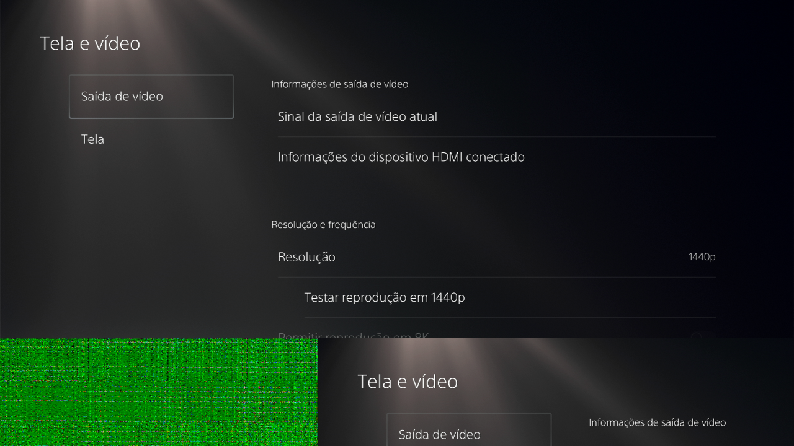

# MS2131 firmware notes

*[Back to the README](../README.md)*

Technical notes behind the patch. Everything was observed on one card and one firmware build
(`Jul 22 2026`, code length `0xf86b`); nothing comes from vendor documentation. Where something is an
inference, it says so.

## What the chip does with a frame

```
HDMI in ─► pre-scaler ─► frame memory ─► output scaler ─► USB (YUY2 / MJPEG)
```

The HDMI input and the USB output run on different clocks, so every frame is stored and read back.

- **Frame memory: two buffers of 2²¹ = 2,097,152 pixel slots each** (4,194,304 in total). The firmware uses
  them as a double buffer; an oversized image wraps at the end of one buffer, which is why an earlier version
  of these notes took 2²¹ for the whole memory. See [Real 1440p](#real-1440p).
- The firmware stores `min(input, output, limit)` on each axis. The stock limit is 1920x1080.
- **Above 170 MHz input pixel clock the stored width is halved** (`mem_w >>= 1` at ROM `0x5a9c`, test
  `pclk > 0x4268` at ROM `0x5a8d`). With a 2560x1440@60 input the registers read: pre-scaler input 2560,
  pre-scaler output 1280, output scaler step ×2.
- A 3840x2160@60 YCbCr 4:2:0 input is reported by the firmware as 1920x1080 at 148.4 MHz: it is halved in
  both directions before the scaler.

With the stock settings no source gives more than about 2.1 million real pixels per frame. The real 1440p
firmware changes those settings; the next section explains how.

## Real 1440p

`tools/patch_real1440p.py` stores and delivers 2560x1440 real pixels at 29.96 fps from a 2560x1440@60
source. Everything below was first done with live register writes (volatile), then built into the
firmware.

### One buffer instead of two

The memory init (ROM `0xb09a`) programs three address windows, 24-bit little-endian, in units of 2 slots:

| Window | Base | End |
|---|---|---|
| 0 | `0xf591..f593` = `0x000000` | `0xf584..f586` = `0x0fffff` |
| 1 | `0xf594..f596` = `0x100000` | `0xf587..f589` = `0x1fffff` |
| 2 (unknown user) | `0xf5a5..f5a7` = `0x180000` | `0xf5a8..f5aa` = `0x1fffff` |

Windows 0 and 1 are a double buffer. Setting the end of window 0 to `0x1fffff` and the base of window 1 to
`0` gives one buffer of 4,194,304 slots, enough for 2560x1440 (3,686,400). The price is the double buffer:
the output reads the same buffer the input writes, so fast motion can tear.

### Pre-scaler at 1:1

`0xf600–0xf61f` are shadow registers. Writing bit 0 of `0xf600` loads them (the firmware does this at ROM
`0x5b2b`, followed by bit 0 of `0xf620` for the output timing). With `0xf606` = 2560 and the strobe, the
pre-scaler passes all 2560 columns. A smaller input width (`0xf604`) crops to the left columns.

### Memory bandwidth

With all 2560 columns, the input side writes about 241 Mpixel/s (the 1440p60 pixel clock). Measured on a
static picture, reading the stored frame 1:1 at a given output pixel clock:

| DRAM clock (PLL2) | 80 MHz read | 96 MHz | 120 MHz | 160 MHz |
|---|---|---|---|---|
| 180 MHz (stock) | clean | corrupt | corrupt | corrupt |
| 184.8 MHz | clean | clean | | |
| 194.4 MHz | | | corrupt | |
| 199.2 MHz | | | clean | |
| 210 MHz | | | clean | corrupt |

"Corrupt" means lines land at wrong addresses, so the picture breaks up. At 80 MHz the frame rate is
80e6 / (2760 × 1480) = 19.6 fps. 30 fps needs 120 MHz, so the DRAM has to run faster than stock. MJPEG
does not help: compression happens after the frame memory.

### DRAM clock

PLL2 at `0xd120..0xd12b` clocks the frame memory (it is powered and programmed right before the DRAM, and the
bandwidth above scales with it). Fout = 24 MHz / M × N / P, with `0xd121` = M − 1, `0xd122` = (N − 1) & 1,
`0xd123` = (N − 1) >> 1, `0xd124` bits 2:0 = P − 1, and lock in bit 0 of `0xd12b`. Stock: M = 4, N = 150,
P = 5, 180 MHz, from the XDATA variable `0x20a9` (init table entry at ROM `0x352e`). The firmware programs
PLL2 at boot and when the stream really powers up; a DirectShow close/open does neither. Changing N and P
while running works: N = 140 with P = 5 (168 MHz) first, then P = 4 (210 MHz, VCO 840 MHz).

`0xf006` is the output pixel clock divider: 480 MHz / (`0xf006` + 1). Stock 2 (160 MHz).

### What the firmware patch adds

A routine at ROM `0xf8ba`, called from the main loop in place of `lcall 0xda4b` at ROM `0x53df`. It does
nothing unless input = 2560x1440 (`0x22b8`), output = 2560x1440 (`0x22de`), format = YUY2 (IRAM `0x30` = 2;
MJPEG is format 1) and the stream runs (`0xf007` & 3 = 3). Then, if any of ten registers differs from the
target, it raises PLL2 to 210 MHz (once) and writes: single buffer, pre-scaler 1:1 + strobe, line pitch
2560, output scaler 1:1 reading 2560 columns, output pixel clock 120 MHz, htotal 2760, vtotal 1451
(29.96 fps) + strobe. In any other mode it restores the two stock buffers. Boot is untouched, so the DRAM is
still trained at 180 MHz and USB/HID behave as stock.

Result on a PS5 Pro at 1440p60: the interpolation test below gives 0.99 on both axes (stock patch: 0.17
horizontally), 29.96 fps, 197 of 197 frames clean over 3 minutes.

## Evidence that the 1440p frames are half-width

For a captured 2560x1440 frame (2560x1440@60 source, patched firmware, scaler at its "1:1" setting), each
pixel was fitted by least squares from its four nearest neighbours of the other column phase:

| Axis | Even phase residual | Odd phase residual | Odd phase coefficients |
|---|---|---|---|
| Horizontal | 13.9 | **2.4** | 0, **0.51, 0.51**, 0 |
| Vertical | 21.7 | 21.4 | −0.10, 0.60, 0.64, −0.15 |

Odd columns are the mean of their neighbours; rows are independent. A 1920x1080 capture shows no such
pattern on either axis. Setting bit 5 of register `0xf65a` turns the interpolated columns into exact
copies of the even ones, which confirms the ×2 stage.

Checks that did **not** catch this: comparing adjacent-pixel differences inside and across pixel pairs
(linear interpolation makes them equal), and looking for spectral content above 640 cycles per width
(interpolation images land there).

## Frame memory size and line pitch

Registers `0xf597` / `0xf599` hold half the number of slots reserved per line (write / read side). Stock
value 960 → 1920 slots per line → 1092 lines.

With the size limit raised and the pitch left at stock, a 1280x1440 stored image wraps after line 1092:



In that 2560x1440 output frame the garbage starts at line 1092 after a 1024-pixel offset, and the rest shows
the top of the picture shifted by 1024 pixels. In stored columns (half the output columns) that is
1092 × 1920 + 512 = 2,097,152 = 2²¹.

A 1280-wide stored image needs only 1280 slots per line (register value 640), leaving 1638 lines. A fixed
640 breaks 1920-wide stored images (they overlap their own lines), so the patch appends a routine that
picks the pitch whenever the stored size is programmed:

```
W = stored width (0xf660), H = stored height (0xf662)
if W > 1920:                             pitch = W / 2
elif H > 1092 and input above 170 MHz:   pitch = 640
else:                                    pitch = 960      stock
```

```
f86b  mov a,r6 / inc dptr / movx @dptr,a     ; finish the original write (height, high byte)
f86e  mov dptr,#0xf660 / movx a,@dptr / mov r5,a / inc dptr / movx a,@dptr / mov r4,a   ; r4:r5 = W
f876  clr c / mov a,#0x80 / subb a,r5 / mov a,#0x07 / subb a,r4 / jnc notwide           ; W > 1920 ?
f87f  r4:r5 >>= 1 / sjmp write                                                          ; pitch = W / 2
notwide:
f888  mov r4,#0x03 / mov r5,#0xc0                                                       ; pitch = 960
f88c  inc dptr / movx a,@dptr / mov r7,a                                                ; height, low byte
f88f  clr c / mov a,#0x44 / subb a,r7 / mov a,#0x04 / subb a,r6 / jnc write             ; H > 1092 ?
f898  setb c / (pixel clock at 0x22bc:0x22bd) - 0x4268 / jc write                       ; input <= 170 MHz ?
f8a7  mov r4,#0x02 / mov r5,#0x80                                                       ; pitch = 640
write:
f8ab  mov dptr,#0xf597 / write r5, r4, r5, r4 to 0xf597..0xf59a / ret
```

[`tools/test_pitch_routine.py`](../tools/test_pitch_routine.py) runs these bytes in a small 8051
interpreter.

**Known problem.** An input at or below 170 MHz with more than 1092 lines (1920x1200@60, 2560x1440@30…)
is not halved, so in the 2560x1440 mode the stored image can exceed the memory. Not tested; expect a
corrupted picture. The stock firmware avoids this with its 1920x1080 limit.

## What the patch changes

File offset = ROM address + 0x30.

| # | What | Where | Change |
|---|---|---|---|
| 1 | USB3 width/height table, slot 12, MJPEG and YUY2 | file `0x018c`, `0x01bc` | 3840x2160 → 2560x1440 (big-endian) |
| 1 | UVC frame descriptor 12, YUY2 and MJPEG | file `0x09f8`, `0x0c21` | size, bit rates, buffer size, interval 555555 → 333333 |
| 2 | Stored size limit (init value of XDATA `0x268c`) | file `0x344a` | `07 80 04 38` → `0a 00 05 a0` |
| 3 | End of the routine that programs the stored size | ROM `0xc263` | → `ljmp 0xf86b` |
| 3 | Pitch routine, 79 bytes | ROM `0xf86b`, after the original code | appended |
| 3 | Code length in the header | file `0x0002` | `0xf86b` → `0xf8ba` |
| 4 | Sharpening off (optional) | file `0x4ddc` | `01` → `00` |
| 5 | Header and code checksums | after the code | recomputed |

126 bytes differ from the stock image (127 with `--no-sharpen`).

## Firmware image layout

- Header, 0x30 bytes: `3C C3`, code length (big-endian) at offset 2, build timestamp at 0x0C.
- 8051 code and data from file offset 0x30 (ROM address 0).
- After the code: header checksum (sum of header bytes 2..0x2F except 0x0C..0x0F) and code checksum (sum
  of the code bytes), both 16-bit big-endian.
- The boot loader honours the code length: the 1440p image is 79 bytes longer (`0xf8ba`) and the real 1440p
  image 404 bytes longer (`0xf9ff`); both boot. Vendor MS2131 builds go up to `0xfba0`.
- ROM `0x2a`: EDID (256 bytes). File `0x160`–`0x217`: four width/height tables (USB3 MJPEG, USB3 YUY2, USB2
  ×2), indexed by UVC frame index. UVC descriptors follow.
- A 14-record output timing table is copied to XDATA `0x1A76` at boot; the stream setup looks the requested
  width × height up in it (ROM `0x998b`). Record, 21 bytes, big-endian: flags, htotal, vtotal, hactive,
  vactive, pixel clock (10 kHz), refresh (0.01 Hz), offsets and sync widths.

## Registers and variables (as observed)

Reachable with HID commands `0xB5` (read) and `0xB6` (write); writes are volatile.

| Address | Meaning |
|---|---|
| `0xf597`, `0xf599` (16-bit LE) | Frame memory line pitch, write / read side; slots per line = 2 × value |
| `0xf604`, `0xf60c` (16-bit LE) | Pre-scaler input width, height |
| `0xf606`, `0xf60e` | Pre-scaler output width, height |
| `0xf660`, `0xf662` | Stored image width, height read by the output scaler |
| `0xf65c`, `0xf65e` | Output scaler step: 16 × stored size / output size, per axis |
| `0xf622`… | Output timing: horizontal total, vertical total, sync widths, active window |
| `0xf6b0` bit 0 | Sharpening filter enable (the firmware sets it for YUY2 streams only) |
| `0xf65a` bit 5 | Output scaler uses pixel repetition instead of linear interpolation |
| `0x268c` (W, H, big-endian) | Stored size limit |
| `0x22b3` | Detected HDMI input timing; pixel clock (10 kHz, big-endian) at `0x22bc` |
| `0x22d9` | Active output timing record |

The output side runs from a 160 MHz clock (divided for small modes) and adjusts the horizontal total to hit
the frame rate: 4040×2200×18, 2370×1125×60 and 3603×1480×30 all come to 160 MHz.

Registers in `0xf600–0xf61f` are shadows: they take effect when bit 0 of `0xf600` is written. Registers in
`0xf58x`, `0xf65x` and `0xf6bx` act immediately; the output timing (`0xf622`…) takes effect with bit 0 of
`0xf620`.

| More addresses | Meaning |
|---|---|
| `0xf584..f589`, `0xf591..f596` | Frame memory windows 0 and 1, end / base (see [Real 1440p](#real-1440p)) |
| `0xf600` bit 0 | Load the pre-scaler shadow registers |
| `0xf620` bit 0 | Load the output timing registers |
| `0xf006` | Output pixel clock = 480 MHz / (value + 1) |
| `0xd120..0xd12b` | PLL2 (DRAM clock) |
| IRAM `0x30` (read with `B5 00 30`) | Current UVC format index: 1 = MJPEG, 2 = YUY2 |

## Sharpening

The filter acts mostly horizontally: with it on, the pixel-level second-difference energy of the same
picture rises 1.71x horizontally and 1.18x vertically.


## HID protocol

Feature reports, report ID 1, 8 data bytes. From [ms213x_flash](https://github.com/steve-m/ms213x_flash).

| Command | Bytes |
|---|---|
| Read XDATA / register | `B5 addr_hi addr_lo` → value in byte 3 of the reply |
| Write XDATA / register | `B6 addr_hi addr_lo value` |
| Read / write SFR | `C5 addr` / `C6 addr value` |
| Read flash page | `F7 01 a2 a1 a0 len_hi len_lo`, then `F7 00 00 00 00 off_hi off_lo` per 8 bytes |
| Write flash page | `F8 01 a2 a1 a0 len_hi len_lo`, then `F8 00` + 6 data bytes, repeated |
| Erase flash | `FE` |

Reading the flash leaves a few chip pins in SPI mode until the next power cycle; re-plug the card after a
backup.
